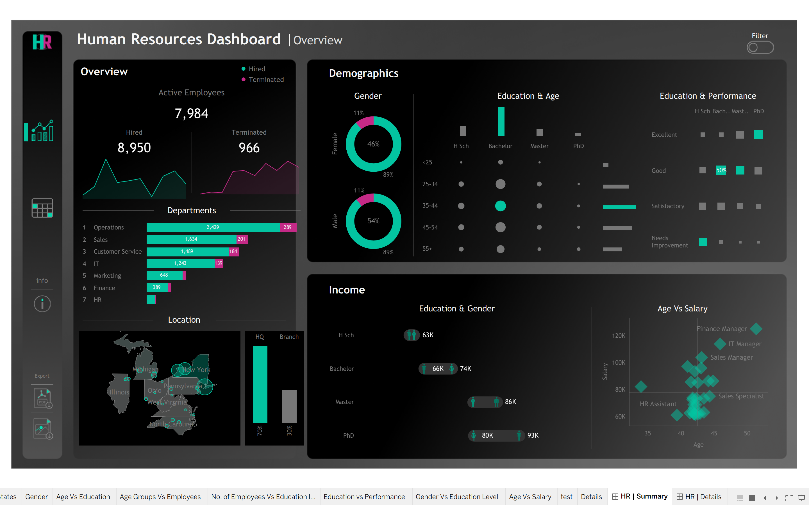
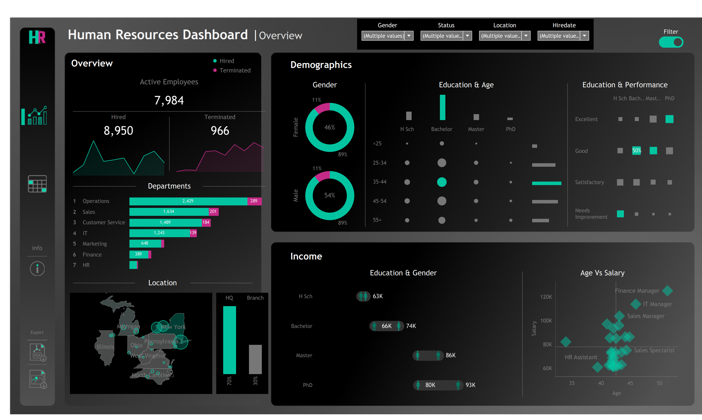
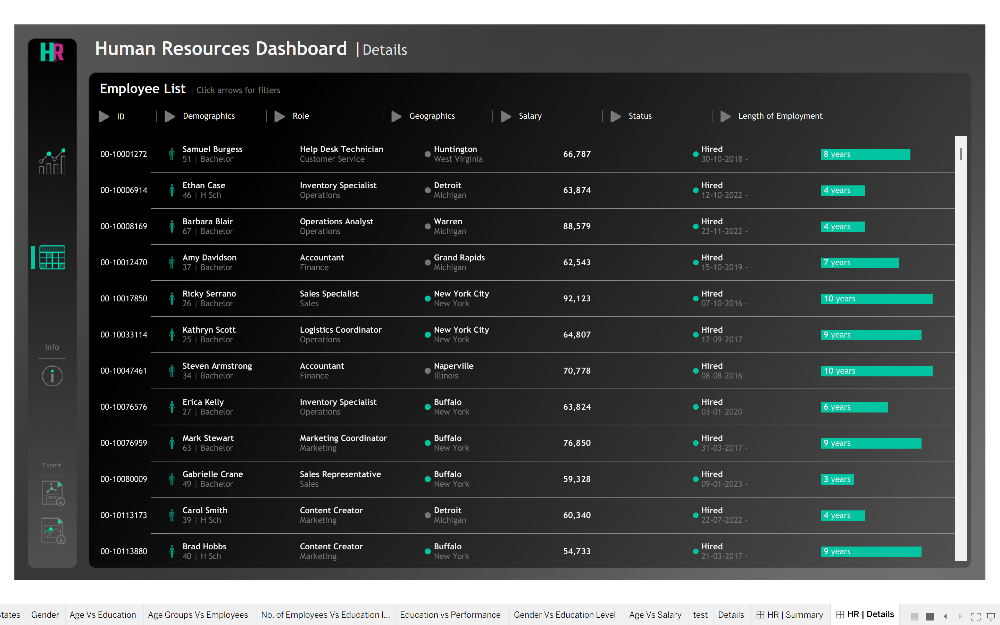
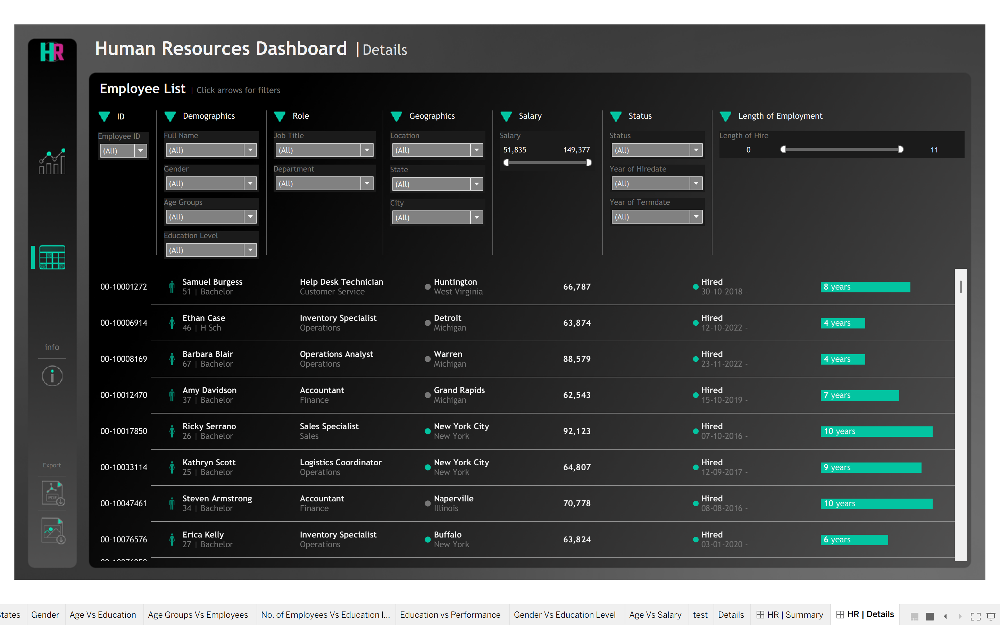

# Human Resources (HR) Analytics Dashboard | Tableau

## 📌 Project Overview

The **Human Resources Analytics Dashboard** is an interactive Tableau project designed to analyze employee demographics, workforce distribution, hiring and termination trends, salary patterns, and employee-related information.

The project provides an overview of the workforce through interactive visualizations and a detailed employee-level view with multiple filtering options. It helps HR teams explore workforce data, identify patterns, and support data-driven decision-making.

## 🎯 Project Objectives

- Analyze the overall workforce, including active employees, hires, and terminations.
- Explore employee demographics by gender, age group, and education level.
- Compare employee distribution and termination counts across departments.
- Examine workforce distribution across geographical locations.
- Analyze salary patterns by age, job role, education, and gender.
- Provide employee-level details through interactive filters.

## 🛠️ Tools & Technologies

- **Tableau Desktop** – Dashboard development and data visualization
- **CSV Dataset** – Employee data source
- **Data Visualization** – Charts, maps, KPI metrics, and interactive dashboards
- **Interactive Filtering** – Parameters and dashboard filters for exploring employee data

## 🗂️ Dataset

The project uses `dataset.csv`, which contains **8,950 employee records** and 14 columns (one row per employee).

| Column | Description |
|---|---|
| Employee_ID | Unique employee ID |
| First Name, Last Name | Employee name |
| Gender | Male / Female |
| State, City | Work location (8 states; New York is the HQ) |
| Education Level | High School, Bachelor, Master, PhD |
| Birthdate, Hiredate, Termdate | Dates in DD/MM/YYYY (Termdate is blank for active employees) |
| Department, Job Title | 7 departments, 28 job titles |
| Salary | Annual salary (51,835 to 149,377) |
| Performance Rating | Excellent, Good, Satisfactory, Needs Improvement |

> The file is **semicolon-separated**. If opened in Excel, use the Text Import option with `;` as the delimiter.

## 📊 Dashboard Preview

### 1. HR Summary Dashboard

The summary dashboard provides a consolidated view of workforce metrics, demographics, departmental distribution, geographical information, and salary patterns.



**Key components:**

- **Workforce Overview:** Active employees, total hires, and total terminations, with hiring and termination trends.
- **Department Analysis:** Department-wise employee distribution and termination counts.
- **Gender Distribution:** Comparison of male and female employees.
- **Education & Age:** Exploration of employee distribution across age groups and education levels.
- **Education & Performance:** Comparison of education levels across performance categories.
- **Geographical Analysis:** Employee distribution across locations, with a comparison of headquarters and branch employees.
- **Education & Gender:** Salary-related comparisons across education levels and gender.
- **Age vs. Salary:** Scatter plot exploring the relationship between employee age, salary, and job roles.

### 2. Interactive Summary Dashboard

The dashboard includes an interactive filter panel that allows users to refine the analysis based on selected employee attributes.



**Available filters:**
- Gender
- Employment status
- Location
- Hire date

These filters enable users to explore different workforce segments and examine how the dashboard metrics and visualizations change with the selected criteria.

### 3. Employee Details Dashboard

The details dashboard provides an employee-level view of the workforce, combining employee information with demographic, professional, geographical, salary, employment-status, and tenure details.



**Employee information includes:**

- Employee ID and full name
- Gender, age, and education level
- Job title and department
- Location, state, and city
- Salary
- Employment status, hire date, and termination date
- Length of employment

The dashboard presents employee information in a structured table, making it easier to explore individual records.

### 4. Interactive Employee Details Dashboard

The details dashboard provides additional filtering options to help users find employees based on specific criteria.



**Available filters:**
- Employee ID and full name
- Gender, age group, and education level
- Job title and department
- Location, state, and city
- Salary range
- Employment status
- Year of hire and year of termination
- Length of employment

These filters support detailed employee-level exploration without manually searching through the entire dataset.

## 🔍 Key Analytical Areas

The project focuses on the following HR analytics areas:

1. **Workforce Analysis:** Understanding active employees, hiring activity, and employee terminations.
2. **Demographic Analysis:** Exploring gender, age-group, and education-level distributions.
3. **Departmental Analysis:** Comparing workforce distribution and terminations across departments.
4. **Compensation Analysis:** Examining salary patterns across age groups, education levels, and job roles.
5. **Geographical Analysis:** Exploring employee distribution across different locations.
6. **Employee-Level Analysis:** Filtering and reviewing individual employee records and employment tenure.

## 📈 Key Insights

- **Workforce:** 8,950 employees hired in total, 7,984 currently active and 966 terminated (about 10.8% attrition).
- **Gender:** 53.6% male and 46.4% female. Termination rates are similar (about 11% for both).
- **Location:** About 70% of employees work at the New York HQ.
- **Departments:** Operations is the largest (2,718 employees). Finance has the highest attrition (about 13.9%).
- **Education and performance:** 48% of PhD holders are rated Excellent, while 34% of High School graduates are rated Needs Improvement.
- **Attrition and performance:** Employees rated Needs Improvement (18.3%) and Excellent (14.9%) leave more often than Good (9.6%) and Satisfactory (6.6%).
- **Salary:** Men earn more at the Bachelor level (about 73.6K vs 65.7K), while women earn more at the Master and PhD levels.
- **Hiring trend:** Hiring peaked in 2017 (1,560 hires) and dipped in 2021 (422 hires).

## ⚠️ Notes & Limitations

- The dataset appears to be sample data, so findings are for learning and portfolio purposes.
- "Hired" on the dashboard means total employees ever hired (including terminated). Active = Hired − Terminated.
- Length of employment is calculated relative to the current date, while the data ends in December 2024.
- Some job titles (for example HR Manager and Finance Manager) have very few employees, so their salary trends should be read with caution.

## 📁 Repository Structure

```text
Tableau-HR-Dashboard-Project/
│
├── HR_Dashboard.twbx
├── dataset.csv
├── Images/
│   ├── Summary.png
│   ├── Summary_Filters.png
│   ├── Details.png
│   └── Details_Filters.png
│
└── README.md
```

## 🚀 How to Use the Project

1. Clone or download this repository.
2. Install Tableau Desktop or another compatible Tableau application.
3. Open `HR_Dashboard.twbx`.
4. If prompted, verify or reconnect the data source.
5. Navigate between the HR Summary and HR Details dashboards.
6. Use the available filters to explore workforce metrics and employee information.

## 💡 Skills Demonstrated

- Tableau dashboard development
- HR analytics and exploratory data analysis
- Data visualization and dashboard layout design
- Interactive filters and dashboard actions
- KPI presentation and workforce reporting
- Comparative and demographic analysis
- Translating employee data into meaningful visual insights

## 👨‍💻 Author

**Abhishek Kumar**

- GitHub: [@vk18abhishek](https://github.com/vk18abhishek)
- Project Repository: [Tableau HR Dashboard Project](https://github.com/vk18abhishek/Tableau-HR-Dashboard-Project)
